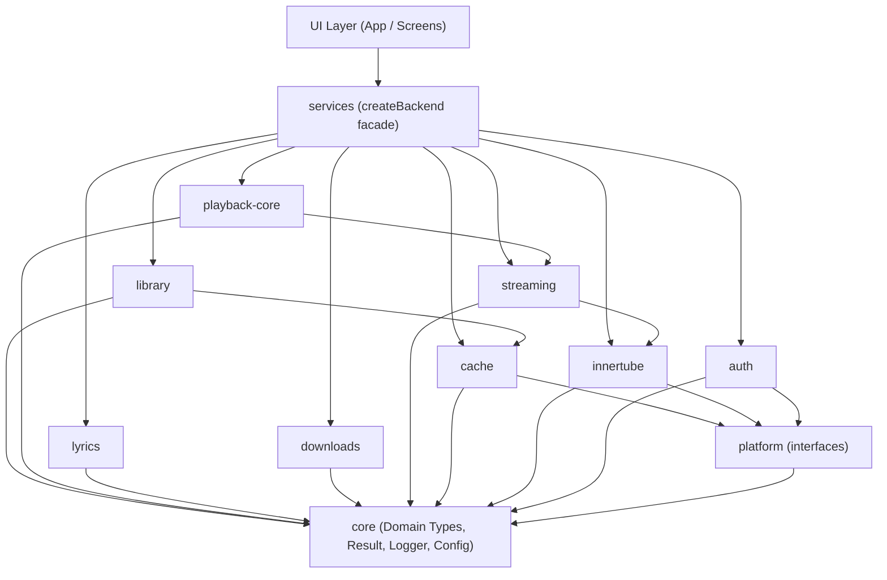
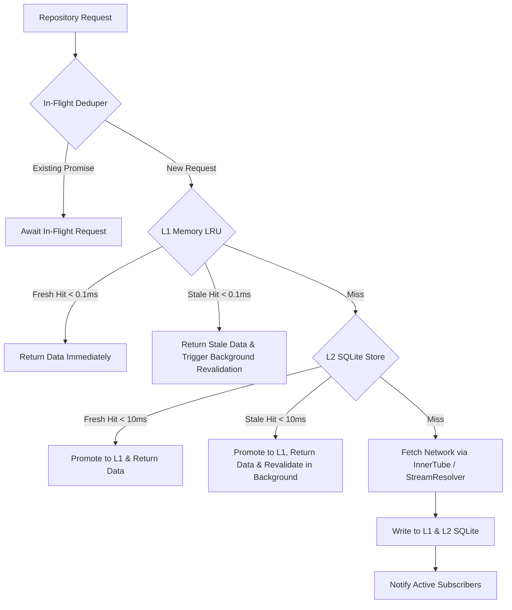
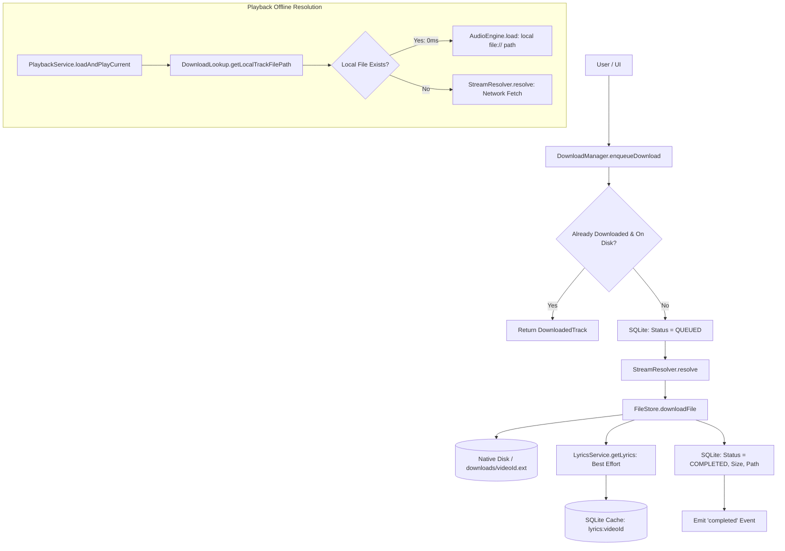

# Vitro Music Player - Backend Architecture

## 1. Overview & Priorities

Vitro Music Player backend is a modular, high-performance, testable TypeScript foundation for an unofficial YouTube Music client built inside an Expo (React Native) project.

### Core Priorities (in order)

1. **Speed**: Sub-100ms cached screen responses, lightweight memory footprint.
2. **Responsiveness**: Stale-while-revalidate (SWR), background revalidation, in-flight request de-duplication.
3. **Audio Quality**: Best available bitrate selection (Opus > AAC), format prioritization, loudness normalization metadata.
4. **Modularity**: Strict ports-and-adapters architecture; isolated domain modules with ESLint-enforced boundaries.
5. **Testability**: Pure Node.js execution via memory adapters without requiring an emulator or UI layer.

---

## 2. Architectural Principles

### Ports and Adapters (Hexagonal Architecture)

- **Ports (Interfaces)**: Domain modules interact exclusively with platform abstractions defined in `platform`:
  - `HttpClient`: Transport for HTTP requests.
  - `SecureStore`: Encrypted storage for authentication tokens and session cookies.
  - `KeyValueStore`: Key-value persistence for settings and fast metadata.
  - `SqlDatabase`: Structured relational storage for cache, history, offline mutations, and playlists.
  - `FileStore`: Binary filesystem storage for cached tracks and offline downloads.
- **Adapters**:
  - `platform/memory`: In-memory implementations for pure Node testing and CLI execution.
  - `platform/rn`: Native Expo/React Native implementations (`expo-secure-store`, `expo-sqlite`, `expo-file-system`, `fetch`).

### Strict Module Encapsulation

- Every module resides in `src/backend/<module>/`.
- Every module exposes its public API through a single barrel file: `src/backend/<module>/index.ts`.
- Deep internal imports into another module's internals (e.g. `import from '@/backend/innertube/parsers/search'` or `import from '../innertube/parsers/search'`) are strictly forbidden and blocked by ESLint.
- No backend code may import from `react` or `react-native`, with the sole exception of adapters inside `src/backend/platform/rn/`.

### Module Dependency Hierarchy



### Explicit Allowed-Dependencies Matrix

To maintain architectural purity and prevent cyclic couplings, cross-module imports are restricted to this explicit dependency matrix (strictly enforced by ESLint):

| Module              | Allowed Imports                                                                                         | Rationale / Prohibited Dependencies                                               |
| :------------------ | :------------------------------------------------------------------------------------------------------ | :-------------------------------------------------------------------------------- |
| **`core`**          | _None_                                                                                                  | Foundation domain models, Result, errors, logger. Cannot depend on any module.    |
| **`platform`**      | `@/backend/core`                                                                                        | Port interfaces and pluggable adapters.                                           |
| **`innertube`**     | `@/backend/core`, `@/backend/platform`, `@/backend/auth`                                                | YouTube endpoint client, parser layer. Uses transport and auth session.           |
| **`auth`**          | `@/backend/core`, `@/backend/platform`                                                                  | Session storage and header generators.                                            |
| **`cache`**         | `@/backend/core`, `@/backend/platform`                                                                  | SWR caching engine (LRU/SQLite). **Strictly forbidden from importing innertube**. |
| **`streaming`**     | `@/backend/core`, `@/backend/platform`, `@/backend/innertube`                                           | Stream resolver and player format strategies.                                     |
| **`library`**       | `@/backend/core`, `@/backend/platform`, `@/backend/innertube`, `@/backend/auth`, `@/backend/cache`      | User library, playlists, optimistic mutation queue.                               |
| **`playback-core`** | `@/backend/core`, `@/backend/platform`, `@/backend/streaming`, `@/backend/innertube`, `@/backend/cache` | Headless playback engine, state machine, prefetch queue.                          |
| **`lyrics`**        | `@/backend/core`, `@/backend/platform`                                                                  | LRCLIB client and timestamp parser.                                               |
| **`downloads`**     | `@/backend/core`, `@/backend/platform`, `@/backend/streaming`, `@/backend/cache`                        | Offline download manager and storage budget.                                      |
| **`services`**      | _All modules_                                                                                           | Composition root (`createBackend`). No module may depend on services.             |

---

## 3. Module Catalog

| Module              | Responsibility                                                                                                                                                         | Key Interfaces & Exports                                                 |
| :------------------ | :--------------------------------------------------------------------------------------------------------------------------------------------------------------------- | :----------------------------------------------------------------------- |
| **`core`**          | Shared domain models (`Track`, `Album`, `Artist`, `Playlist`), `Result<T, E>`, typed errors, logger with redaction, clock, event emitter, perf markers.                | `Result`, `Track`, `Logger`, `Clock`, `EventEmitter`                     |
| **`platform`**      | Port interfaces and pluggable adapters (`memory` and `rn`).                                                                                                            | `HttpClient`, `SecureStore`, `KeyValueStore`, `SqlDatabase`, `FileStore` |
| **`innertube`**     | YouTube Music endpoint client (search, browse/home, album, artist, playlist, next/radio, continuations), visitorData/locale handling, and defensive Zod-based parsers. | `InnertubeClient`, `SearchResponse`, `BrowseResponse`                    |
| **`auth`**          | Cookie/session management via SecureStore, SAPISID/visitor token headers, session health checks, `setSessionFromCookies()` ingestion.                                  | `AuthService`, `Session`                                                 |
| **`streaming`**     | Pluggable stream resolution strategies, audio format ranking (high-bitrate Opus > AAC), signature/token handling, URL expiration tracking and re-resolution.           | `StreamResolver`, `AudioStream`                                          |
| **`cache`**         | Multi-tier cache (in-memory LRU + SQLite), stale-while-revalidate policies, in-flight request coalescing.                                                              | `CacheManager`, `CachePolicy`                                            |
| **`library`**       | User playlists, liked songs, playback history, optimistic mutations, offline mutation queue with retry logic.                                                          | `LibraryService`, `MutationQueue`                                        |
| **`playback-core`** | Headless playback state machine (play, pause, next, prev, shuffle, repeat, auto-queue), prefetch planner, and `AudioEngine` interface.                                 | `PlaybackStateMachine`, `AudioEngine`                                    |
| **`lyrics`**        | Timed LRC parsing, multi-provider lyrics engine with LRCLIB provider and fallback ordering.                                                                            | `LyricsProvider`, `ParsedLyrics`                                         |
| **`downloads`**     | Offline track download manager, queue, pause/resume, storage quota budget, metadata indexing.                                                                          | `DownloadManager`                                                        |
| **`services`**      | Composition root: `createBackend(adapters)` returning a unified, strongly-typed facade for UI consumption.                                                             | `createBackend`, `Backend`                                               |

---

## 4. Error Handling & Defensive Boundary Validation

1. **Defensive Parsing with Zod**:
   - The unofficial InnerTube API evolves without public changelogs.
   - All external HTTP response payloads must pass through defensive Zod schemas at the boundary.
   - Optional or renamed properties must degrade gracefully into safe domain defaults rather than throwing unhandled exceptions.

2. **Result Pattern**:
   - Operations that can fail return `Result<T, E>` (`{ ok: true, value: T }` or `{ ok: false, error: E }`).
   - Domain errors are strongly typed classes or discriminated unions, avoiding raw exception throwing in business logic.

---

## 5. Security & Privacy

1. **Redaction in Logging**:
   - Sensitive headers (`Authorization`, `Cookie`, `X-Goog-Visitor-Id`, `SAPISIDHASH`) and tokens are redacted before outputting to logs.
2. **Credential Storage**:
   - Authentication tokens and session cookies are stored only in `SecureStore` (native keychain on mobile, memory adapter during tests).
3. **Repository Hygiene**:
   - Sensitive fixtures, cookie dumps, session files, and cache databases are explicitly excluded via `.gitignore`.
   - Recorded API fixtures must be scrubbed of user identifiers and session cookies.

---

## 6. Tooling & Verification Workflow

- **Unit Testing**: Vitest running in pure Node.js (`npm test`).
- **Terminal CLI**: Node runner via tsx (`npm run cli -- <command>`) for exploring endpoints without starting the React Native runtime or emulator.
- **Architectural Linting**: ESLint flat config (`npm run lint`) enforces cross-module import boundaries and prevents React Native imports in domain code.
- **Type Checking**: TypeScript strict mode (`npm run typecheck`).
- **Formatting**: Prettier (`npm run format` / `npm run format:check`).

---

## 7. Cache Architecture & Design

### Two-Tier Storage Architecture



1. **L1 In-Memory LRU (`LruCache`)**:
   - Sub-millisecond synchronous retrieval ($< 0.1\text{ ms}$).
   - Tracks both item count (`maxEntries`, default 200) and byte size (`maxSizeBytes`, default 20 MB).
   - Evicts least-recently-used items when limits are exceeded.

2. **L2 SQLite Persistence (`SqlCacheStore`)**:
   - Durable relational persistence through the `SqlDatabase` port (`expo-sqlite` on device, `node:sqlite` / `MemorySqlDatabase` in Node).
   - Indexed table `cache_entries` on `key`, `data_type`, and `stale_until` for fast index scans and background pruning (`deleteExpired`).

### Stale-While-Revalidate (SWR) Engine

- **Fresh Hit**: Returned immediately without invoking the network fetcher.
- **Stale Hit**: Cached data is returned immediately ($< 1\text{ ms}$), satisfying the sub-100ms screen render requirement. In the background, `revalidateInBackground()` initiates an in-flight deduplicated fetch. When fresh data arrives, it updates the cache and notifies active subscribers registered via `observe...()`.
- **Miss**: Underlying fetcher executes via `InFlightDeduper`, writes fresh data to both tiers, and returns.

### Per-Data-Type Policies & Expiry-Aware Dynamic TTL

| Data Type     | Fresh TTL | Stale TTL | SQLite Persistence | Notes |
| :------------ | :-------- | :-------- | :----------------- | :---- |
| **`home`**     | 10 min    | 24 hours  | Yes (`true`)       | Feed shelves and carousels. |
| **`search`**   | 5 min     | 1 hour    | Yes (`true`)       | Query results with normalized whitespace and filter. |
| **`album`**    | 24 hours  | 7 days    | Yes (`true`)       | Album metadata and tracklist. |
| **`artist`**   | 12 hours  | 3 days    | Yes (`true`)       | Artist profile and discography. |
| **`playlist`** | 15 min    | 24 hours  | Yes (`true`)       | Curated/user playlist items. |
| **`suggest`**  | 30 min    | 2 hours   | Yes (`true`)       | Search autocomplete queries. |
| **`stream`**   | Dynamic   | Dynamic   | **No (`false`)**   | **In-Memory Tier Only**. Dynamic safety margin based on stream `expiresAt`. |

### Stream URLs In-Memory Only & Invalidation Rule

- **Rationale**: YouTube signed stream URLs are bound to the client IP address (via the `ip=` URL query parameter) and cryptographic signatures (`sig=`/`s=`). When a device switches networks (e.g. Wi-Fi to cellular or VPN), existing signed stream URLs immediately return **HTTP 403 Forbidden**.
- **Rule**: Stream URLs are marked `persistToSql: false` and are **never persisted to SQLite**.
- **Invalidation**: `invalidateStream(videoId)` purges the cached stream entry from memory, guaranteeing that the next playback attempt re-resolves a fresh URL under the current network route.

### Parsed Domain Models (Not Raw Responses)

The cache strictly stores parsed domain models rather than raw InnerTube JSON payloads:
- Discards all tracking tokens, command metadata, visual styling trees, and menu overlays.
- Stored payload sizes:
  - `search`: ~5.1 KB (vs ~150–300 KB raw response; **~97% reduction**)
  - `home`: ~13.6 KB (vs ~200–400 KB raw response; **~95% reduction**)
  - `album`: ~6.1 KB (vs ~120 KB raw response; **~95% reduction**)
  - `artist`: ~6.5 KB (vs ~130 KB raw response; **~95% reduction**)
  - `playlist`: ~8.3 KB (vs ~100 KB raw response; **~92% reduction**)
  - `next`: ~2.3 KB (vs ~80 KB raw response; **~97% reduction**)
  - `suggest`: ~0.4 KB (vs ~10 KB raw response; **~96% reduction**)
  - `stream`: ~0.3 KB (vs ~180 KB raw player response; **~99.8% reduction**)

### Auth Isolation & Logout Purge (`clearUserScopedData`)

- Cache keys are generated via `CacheKeyBuilder` and strictly scoped:
  - Guest queries: `browse:home:auth:guest`, `search:...`
  - User-authenticated queries: `browse:home:auth:user:<id>`, `auth:user:<id>:search:...`
- On user logout or account switch, `clearUserScopedData()` purges all entries scoped under `auth:user:*` from both L1 memory LRU and L2 SQLite, while preserving anonymous guest cache entries.

### Prefetch Planner (`PrefetchPlanner`)

- Proactively monitors the active playback queue.
- Given the current track index, prefetches audio stream URLs for the next 1–2 tracks.
- Skips tracks already warm in cache and re-resolves any stream within 5 minutes of provider expiration.

### Dependency Rules & Boundary Enforcement

- `cache` is a low-level module that imports **only `core` and `platform`**.
- `cache` is **strictly prohibited from importing `innertube` or `streaming`** (enforced by ESLint).
- The repository layer (`MusicRepository` in `services`) serves as the mediator between InnerTube, Streaming, and Cache.

---

## 8. Auth Module Architecture

### Overview

The auth module (`src/backend/auth`) provides headless session management, encrypted persistent credentials storage, cryptographic request signature generation (`SAPISIDHASH`), session health checks, and secure logout orchestration.

```mermaid
flowchart TD
    LoginModal[Dev WebView Sign-In] -->|Cookie Jar String| AuthService
    AuthService -->|parseCookieString| Session[AuthSession]
    Session -->|Chunk <= 1500B| SessionStore
    SessionStore -->|auth_session_chunk_N| SecureStore[SecureStore Port]
    
    Innertube[InnertubeClient] -->|getAuthHeaders| AuthService
    AuthService -->|SAPISID + Timestamp| Sha1Port[Sha1Port (Crypto)]
    Sha1Port -->|SHA1 Digest| Hash[SAPISIDHASH Header]
    
    Resolver[StreamResolver] -->|recoverableWithAuth?| AuthStrat[AuthenticatedStreamStrategy]
    AuthStrat -->|Signed Headers| YTMPlayer[InnerTube Player Endpoint]

    Logout[AuthService.logout] --> ClearStore[Clear SecureStore Chunks]
    Logout --> ClearMemory[Clear Memory Session]
    Logout --> ClearCookies[Clear WebView Cookie Jar]
    Logout --> ClearCache[cache.clearUserScopedData]
    Logout --> ClearVisitor[innertube.resetVisitorData]
```

### Chunked SecureStore Storage

- **Android SharedPreferences Limit**: Android's `SharedPreferences` (used by `expo-secure-store`) limits single entry sizes to ~2048 bytes. Standard YouTube Music session cookie headers frequently exceed 3–6 KB.
- **Chunking Algorithm**: `SessionStore` serializes `AuthSession` JSON and divides the string into slices of `SESSION_CHUNK_SIZE` (1500 bytes).
  - Slices are saved as `auth_session_chunk_0`, `auth_session_chunk_1`, etc.
  - Metadata `auth_session_chunk_count` tracks chunk count.
  - Surplus chunks from prior writes are explicitly deleted during overwrites.
  - `SessionStore` falls back to reading legacy non-chunked keys if upgrading.

### Cryptographic Hash Port (`Sha1Port`)

- **Port Interface**: `Sha1Port { digestHex(data: string): Promise<string> }` defined in `src/backend/platform/types.ts`.
- **Node Adapter**: `NodeSha1` in `src/backend/platform/memory/node-sha1.ts` using Node's standard `node:crypto`.
- **React Native Adapter**: `RnSha1` in `src/backend/platform/rn/rn-sha1.ts` using `expo-crypto` (`Crypto.digestStringAsync`).
- **Signature Calculation**: YouTube Music authenticated requests require an authorization header generated as:
  $$\text{SAPISIDHASH } = \text{timestamp} + \text{"\_"} + \text{SHA1}(\text{timestamp} + \text{" "} + \text{SAPISID} + \text{" "} + \text{origin})$$
  with default origin `https://music.youtube.com`.

### Authenticated InnerTube & Cache Scoping

- **InnerTube Ingestion**: When `AuthService.isSignedIn()` is true, `InnertubeClient` attaches:
  - `Authorization: SAPISIDHASH <timestamp>_<digest>`
  - `Cookie: <serialized session cookies>`
  - `X-Origin: https://music.youtube.com`
- **Cache Scoping**: In `MusicRepository`, cache queries dynamically use scope `user:<accountId>` when signed in versus `guest` when anonymous. This guarantees that user and guest queries never collide or share cache keys.

### Authenticated Stream Findings & Auto-Fallback Policy

Empirical testing on real Android emulator runs revealed the following stream resolution behaviors:
- **Guest Strategy Capability**: The unauthenticated `visionos` strategy successfully resolves both standard tracks (`"9RfVp-GhKfs"` in ~182ms, Opus 150.1 kbps, HTTP 206) and age-restricted / bot-checked tracks (`"VYOjWnS4cMY"` *This Is America* in ~971ms, Opus 150.3 kbps, HTTP 206).
- **Authenticated Strategy Limitations**:
  - `authenticated-visionos`: Returns `HTTP 400` from `/youtubei/v1/player` because YouTube's native Apple RealityDevice client context rejects web browser authentication cookies (`SAPISIDHASH` / `HSID` / `SSID`).
  - `authenticated-webremix`: Returns `STREAM_ERROR: Video is not playable (UNPLAYABLE)` because desktop `WEB_REMIX` requires JavaScript signature timestamp ciphering (`s=` / `n=`) and Proof-of-Origin tokens (PoToken) which are not present in headless environments.
- **Auto-Fallback Disabled**: Because authenticated strategies fail or return unplayable without ciphering, automatic fallback in `DefaultStreamResolver` is disabled by default (`enableAuthFallback: false`). This avoids wasting an extra network round-trip on failed tracks. Direct testing remains accessible via `DefaultStreamResolver.getAuthenticatedStrategy()`.

### Full Logout Lifecycle

Invoking `authService.logout()` executes atomic cleanup across all tiers:
1. Deletes all encrypted session chunks and metadata from `SecureStore`.
2. Resets the in-memory active session reference to `null`.
3. Invokes the native cookie jar clearer (`@react-native-cookies/cookies` `CookieManager.clearAll()`).
4. Executes `cache.clearUserScopedData()`, wiping all SQLite and memory entries under `auth:user:*`.
5. Executes `innertube.resetVisitorData()`, clearing the anonymous visitor token from memory and `KeyValueStore`.
6. Executes `library.clearUserData()`, purging the `pending_mutations` and `user_likes` SQLite tables to prevent data leakage across accounts.

### Security & Privacy Enforcements

1. **Zero Credentials in Code/Logs**: No tokens, passwords, cookies, or account emails are ever logged or hardcoded.
2. **Logged Redaction**: HTTP client and error loggers automatically redact `Authorization`, `Cookie`, `X-Goog-Visitor-Id`, and `SAPISIDHASH`.
3. **Recorded vs Sanitized Fixtures**: Any response recorded while authenticated is strictly confined to `fixtures/recorded/` (which is gitignored) and must **never** be checked into `fixtures/sanitized/`.
4. **Whoami Anonymity**: The CLI `whoami` check reports only boolean sign-in status and anonymized deterministic account hashes (`account_<sha1_prefix>`), never cookies or personal user profiles.

---

## 9. Library Module Architecture

### Overview

The library module (`src/backend/library`) manages authenticated user data, playlists, liked tracks, listening history, and offline mutation queues with optimistic updates.

```mermaid
flowchart TD
    UI[UI Layer / Backend Facade] --> LibService[LibraryService]
    LibService --> AuthGate{Auth Check: Active Session?}
    AuthGate -->|No| MissingSession[AuthError: MISSING_SESSION]
    AuthGate -->|Yes| CacheCheck{Cache Check: auth:user:id:library:...}
    
    CacheCheck -->|Fresh Hit| ReturnData[Return Cached Data]
    CacheCheck -->|Stale / Miss| InnertubeClient[InnertubeClient Browse]
    InnertubeClient -->|RPC| YTM[music.youtube.com /browse]
    YTM --> Parsers[Defensive Library Parsers]
    Parsers --> CacheWrite[Write Cache (user-scoped)]
    
    UI -->|setLiked / addTrack| Mutate[Optimistic Mutation]
    Mutate --> LocalOverlay[Update user_likes & Cache Optimistically]
    Mutate --> Queue[Enqueue in pending_mutations (SqlDatabase)]
    Mutate --> NetAttempt{Network Execution}
    NetAttempt -->|Success| RemoveQueue[Remove from pending_mutations]
    NetAttempt -->|Transient / Offline| KeepQueue[Preserve PENDING in Queue for Drain]
    NetAttempt -->|Fatal 400 Rejection| Rollback[Roll Back user_likes & Cache]
```

### Defensive Read Operations

All library endpoints use authenticated `WEB_REMIX` `/browse` requests and are parsed with defensive Zod schemas:
- `fetchUserPlaylists(limit?, continuation?)`: browses `FEmusic_liked_playlists`. Parses `gridRenderer` and `musicTwoRowItemRenderer` elements into `UserPlaylist[]` models.
- `fetchLikedSongs(limit?, continuation?)`: browses `FEmusic_liked_videos`. Parses `musicPlaylistShelfRenderer` and `musicResponsiveListItemRenderer` tracks into `Track[]`, automatically merging local optimistic like/unlike states.
- `fetchHistory(limit?, continuation?)`: browses `FEmusic_history`. Parses `sectionListRenderer` shelves into `HistoryItem[]` models with `playedAt` groupings (e.g. "Today", "Yesterday").

### Auth Gating & Cache Scoping

- Every method checks `AuthService.getSession()` prior to network or cache interaction. Unauthenticated calls immediately reject with typed `AuthError(reason: 'MISSING_SESSION')`.
- All cached library queries use auth-scoped keys:
  - `auth:user:<accountId>:library:playlists`
  - `auth:user:<accountId>:library:liked_songs`
  - `auth:user:<accountId>:library:history`
- When user logs out, `cache.clearUserScopedData()` purges all library entries from both L1 memory LRU and L2 SQLite.

### Offline Mutation Queue (`MutationQueue`)

The offline queue persists pending mutations in `SqlDatabase` across application restarts:
- Table `pending_mutations`: stores `id`, `account_id`, `type`, `payload`, `created_at`, `retry_count`, `last_attempt_at`, `status`, and `error`.
- Table `user_likes`: maintains local optimistic like state (`account_id`, `video_id`, `status: LIKE | DISLIKE | INDIFFERENT`, `updated_at`).
- **Optimistic Application**:
  - `setLiked`: updates `user_likes` immediately and adjusts cached liked songs before making the network RPC.
  - `addTrackToPlaylist` & `removeTrackToPlaylist`: optimistically update playlist metadata and dispatch `/browse/edit_playlist`.
- **FIFO Queue Draining**:
  - `drainQueue()` iterates through pending mutations in chronological sequence.
  - If a transient network error occurs, draining halts to preserve ordering until connectivity is restored.
  - On fatal rejection (HTTP 400 client errors), changes are rolled back to their prior state (`previousStatus`) and marked failed.

---

## 10. Playback Core Module Architecture

### Overview

The playback core module (`src/backend/playback-core`) is a pure TypeScript, headless audio orchestrator and queue state machine with zero React Native dependencies. Native player engines (e.g., `react-native-track-player`) connect through the `AudioEngine` port interface.

```mermaid
flowchart TD
    UI[UI Layer / App Controls] --> Service[PlaybackService]
    Service --> QueueMgr[QueueManager (State Machine)]
    QueueMgr -->|Current Track| Service
    
    Service --> StreamCheck{Stream Expired or < 60s?}
    StreamCheck -->|Yes| Invalidate[resolver.invalidateStream]
    StreamCheck -->|No| FetchStream[resolver.resolveStream]
    Invalidate --> FetchStream
    
    FetchStream --> EngineLoad[AudioEngine.load url, requestHeaders, metadata]
    EngineLoad --> EnginePlay[AudioEngine.play]
    
    Service --> Prefetch[PrefetchPlanner: Resolve Next 1-2 Tracks]
    
    Engine[AudioEngine Event: onError] --> Is403{HTTP 403 or Network Error?}
    Is403 -->|Yes & Not Retried| Retry[Invalidate Stream -> Re-resolve -> Retry Playback]
    Is403 -->|No or Already Retried| ErrorState[Transition to ERROR State]
    
    Engine[AudioEngine Event: onTrackEnded] --> NextTrack[QueueManager.next]
    NextTrack -->|Queue Depleted & autoRadio| GetNext[innertube.getNext -> Extend Queue]
    
    Service --> StatePersist[Persist State to KeyValueStore (no stream URLs)]
```

### 1. `AudioEngine` Port Interface

Platform-agnostic contract defined in `src/backend/playback-core/types.ts`:
- **Methods**:
  - `load(url: string, headers: Record<string, string>, metadata: AudioTrackMetadata): Promise<void>`: Loads an audio stream. Passes `stream.requestHeaders` (e.g., `User-Agent`, `Accept`) ensuring CDN authorization and bypass of bot blocks.
  - `play(): Promise<void>`
  - `pause(): Promise<void>`
  - `seekTo(positionMs: number): Promise<void>`
  - `setVolume(volume: number): Promise<void>` (0.0 to 1.0)
  - `stop(): Promise<void>`
  - `release(): Promise<void>`
- **Event Subscriptions**:
  - `onStateChange((state: AudioEngineState) => void): () => void`
  - `onPositionChange((positionMs: number, durationMs: number) => void): () => void`
  - `onTrackEnded(() => void): () => void`
  - `onError((error: AudioEngineError) => void): () => void`
- **Adapters**:
  - `FakeAudioEngine`: In-memory implementation in `src/backend/playback-core/fake-audio-engine.ts` used for automated unit testing, CLI execution, and dev debugging without native audio devices.
  - Native Audio Engine: `react-native-track-player` adapter implemented under `src/backend/platform/rn/` (Phase 8).

### 2. State Machine & Queue Manager (`QueueManager`)

- **States (`PlaybackCoreStatus`)**: `IDLE`, `LOADING`, `BUFFERING`, `PLAYING`, `PAUSED`, `ENDED`, `ERROR`.
- **Queue Operations**:
  - `setQueue(tracks, startIndex)`: Initialises the active queue and original queue order.
  - `playNext(track)`: Inserts track immediately following the currently playing index.
  - `addToQueue(track)`: Appends track to the tail of the queue.
  - `removeFromQueue(index)`: Removes item at given index; maintains active playback if removing other indices.
  - `moveInQueue(fromIndex, toIndex)`: Reorders tracks in queue.
  - `clearQueue()`: Clears queue and resets to `IDLE`.
  - `next()`: Advances to the next track. Respects `repeatMode: ONE` (replays same track) and `repeatMode: ALL` (loops to 0 upon reaching end).
  - `previous()`: If playback position exceeds 3,000ms (3s threshold), restarts the current track. Otherwise, jumps to previous track.
- **Repeat & Shuffle**:
  - `repeatMode`: `OFF`, `ONE`, `ALL`.
  - `shuffle`: When enabled, applies Fisher-Yates shuffle to remaining unplayed tracks while retaining original queue array (`originalQueue`). When disabled, restores exact original playlist ordering while keeping current track intact.

### 3. Stream Expiry, Recovery & Prefetch

- **Expiry Verification**: Prior to loading, `PlaybackService` inspects the cached stream expiration timestamp (`expiresAt`). If the URL expires within 60 seconds (or is already expired), it invalidates the stream cache and requests a fresh signed URL.
- **HTTP 403 Network Recovery**: If the `AudioEngine` emits an error containing HTTP 403, 401, or network stream failure, `PlaybackService` automatically invalidates the cached stream for that `videoId`, re-resolves a fresh stream from `StreamResolver`, and retries playback once before propagating the error.
- **Background Prefetching**: When a track starts loading or advancing, `PlaybackService` queries upcoming tracks (1-2 tracks ahead) and resolves their streams into the in-memory stream cache in the background.
- **Queue Continuation (Auto-Radio)**: When playback reaches the end of the queue and `autoRadio` is enabled, `PlaybackService` calls `innertube.getNext(currentTrack.id)` to discover related tracks and appends them to the queue seamlessly.

### 4. Cold-Start State Persistence

- Playback state is persisted to `KeyValueStore` under key `playback:state`:
  - `queue`: `Track[]`
  - `originalQueue`: `Track[]`
  - `currentIndex`: `number`
  - `positionMs`: `number`
  - `repeatMode`: `PlaybackRepeatMode`
  - `shuffle`: `boolean`
  - `isAutoRadio`: `boolean`
- **Security Rule**: Stream URLs are IP-bound and transient; they are **never included** in persistent storage. On cold start, `restorePersistedState()` reconstitutes the queue and settings, while streams are freshly resolved on demand.

---

## 11. Lyrics Module Architecture

### Overview

The lyrics module (`src/backend/lyrics`) provides synchronized and plain-text lyrics fetching, LRC format parsing, real-time active lyric line resolution via binary search, and multi-tier positive and negative caching.

```mermaid
flowchart TD
    UI[UI / Mini-Player / Lyrics View] --> LyricsService[LyricsService]
    LyricsService --> CacheCheck{Cache Check: lyrics:videoId}
    
    CacheCheck -->|Fresh Hit < 1ms| ReturnCached[Return Cached LyricsResult]
    CacheCheck -->|Stale Hit| ReturnStale[Return Stale & Revalidate in Background]
    CacheCheck -->|Miss| Lrclib[LrclibProvider]
    
    Lrclib --> ExactGet{GET /api/get?track&artist&duration}
    ExactGet -->|200 OK| ParseLrc[parseLrc Parser]
    ExactGet -->|404 Not Found| Clean[cleanTrackTitle]
    Clean --> SearchFallback{GET /api/search?q=cleanTitle+artist}
    
    SearchFallback --> DurationMatch{Filter Candidates: |duration - target| <= 5s}
    DurationMatch -->|Match Found| ParseLrc
    DurationMatch -->|No Match| NegativeCache[Cache Empty Result: 1h TTL]
    
    ParseLrc --> CachePositive[Cache LyricsResult: 7d TTL in Memory & SQLite]
    CachePositive --> ReturnResult[Return LyricsResult]
    NegativeCache --> ReturnEmpty[Return LyricsResult syncType: NONE]
```

### 1. Domain Models & Active Line Resolution

- **Models (`src/backend/lyrics/types.ts`)**:
  - `LyricLine`: `{ startTimeMs: number; text: string; words?: { startTimeMs: number; text: string }[] }`
  - `LyricsResult`: `{ videoId: string; source: 'LRCLIB' | 'INNERTUBE'; syncType: 'LINE_SYNCED' | 'PLAIN' | 'NONE'; syncedLines: LyricLine[]; plainText: string | null; instrumental: boolean }`
- **Active Lyric Resolution (`getActiveLyricIndex`)**:
  - Employs binary search $O(\log N)$ on sorted `syncedLines`.
  - Given `positionMs`, returns the largest index $i$ such that `lines[i].startTimeMs <= positionMs`.
  - Returns `-1` if playback position is prior to the first lyric line or if `syncedLines` is empty.
  - Guarantees $60\text{ fps}$ smooth highlighting without scanning full lyric arrays on every position tick.

### 2. Defensive LRC Format Parser (`parseLrc`)

- **Format Compatibility**:
  - Parses standard 2-digit centisecond timestamps (`[mm:ss.xx]`), 3-digit millisecond timestamps (`[mm:ss.xxx]`), and 1-digit tenth-second timestamps.
  - Multi-timestamp support: Lines containing multiple timestamps (e.g., `[00:10.00][00:20.00] Chorus`) are expanded into discrete, individual `LyricLine` objects.
  - Metadata tag parsing: Tags such as `[ar:Artist]`, `[ti:Title]`, `[al:Album]` are recorded into a `metadata` dictionary and stripped from lyrics lines.
  - Timing offset: Supports `[offset:+/-ms]`, adjusting all timestamps accordingly and clamping timestamps to $\ge 0$.
  - Chronological sorting: Enforces strict chronological order by `startTimeMs` regardless of source line arrangement.

### 3. Track Title Cleaning & Provider Strategy (`LrclibProvider`)

- **Noise Stripping (`cleanTrackTitle`)**:
  - YouTube video titles frequently include video-specific or channel annotations that cause external lyric lookups to fail with 404.
  - Strips annotations including: `(Official Video)`, `(Official Music Video)`, `[Official Audio]`, `(Visualizer)`, `(Lyrics)`, `(feat. ...)`, `ft. ...`, `(Remastered ...)`, and `(Live ...)`.
- **LRCLIB Provider (`https://lrclib.net/api`)**:
  - Primary lookup: `/api/get` with `track_name`, `artist_name`, `album_name`, and integer `duration`.
  - Fallback lookup: On 404, queries `/api/search?q=<cleaned_title> <artist>`.
  - Duration constraint: Candidates returned from search are filtered strictly within $\pm 5\text{ seconds}$ of the track's duration to prevent false matches on acoustic versions, covers, or unrelated songs with identical titles.
  - Instrumental handling: Flags tracks marked `instrumental: true` with `syncType: NONE`.

### 4. Two-Tier Positive & Negative Caching

- **Cache Keys**: Built via `CacheKeyBuilder.lyrics(videoId)` $\to$ `lyrics:<videoId>`.
- **Scope**: Public domain (`guest` scope); cached across all accounts and persisted to L2 SQLite.
- **Positive Caching**: When valid lyrics (synced or plain) or confirmed instrumental metadata are returned, entries are cached with a **7-day fresh TTL** (`freshTtlMs: 604,800,000`, `staleTtlMs: 1,209,600,000`, `persistToSql: true`).
- **Negative Caching**: If LRCLIB returns no match or 404, an empty `LyricsResult` (`syncType: 'NONE'`) is stored with a **1-hour fresh TTL** (`freshTtlMs: 3,600,000`, `staleTtlMs: 7,200,000`, `persistToSql: true`). This prevents redundant network round-trips for tracks without lyrics during repeated playback.
- **Bypass**: Passing `forceRefresh: true` bypasses cache and queries LRCLIB directly.

---

## 12. Downloads & Offline Architecture

### Overview

The downloads module (`src/backend/downloads`) provides offline-first track downloads, binary file streaming directly to disk, SQLite state persistence, and automatic offline-first stream resolution integration for `PlaybackService`.



### 1. Binary Stream Handling & `FileStore` Port

- **Zero-Copy / Native Disk Streaming**:
  - Audio streams are large binary files (3–10 MB, `audio/webm` Opus or `audio/mp4` AAC).
  - Multi-megabyte binary payloads are never loaded into UTF-8 JavaScript strings or V8 memory heap.
  - `FileStore` port defines `downloadFile(url, destPath, headers)`:
    - **`RnFileStore`**: Uses Expo FileSystem (`File.downloadFileAsync(url, file, { headers, idempotent: true })`). The native thread streams HTTP response chunks straight to the filesystem without crossing the React Native bridge.
    - **`NodeFileStore`**: Uses Node.js `fetch` + `stream.pipeline` / `fs.createWriteStream` in CLI environments, isolated via dynamic safe imports so React Native Metro never evaluates `node:fs`.
    - **`MemoryFileStore`**: Simulates file downloads for deterministic unit testing.

### 2. Domain Models & SQLite Persistence

- **Models (`src/backend/downloads/types.ts`)**:
  - `DownloadStatus`: `'QUEUED' | 'DOWNLOADING' | 'COMPLETED' | 'FAILED'`
  - `DownloadedTrack`: `{ videoId: string; track: Track; filePath: string; sizeBytes: number; mimeType: string; codec: string; bitrate: number; downloadedAt: number }`
- **SQLite Schema (`downloads` table)**:
  - `video_id` (TEXT PRIMARY KEY)
  - `track_json` (TEXT NOT NULL)
  - `file_path` (TEXT NOT NULL)
  - `size_bytes` (INTEGER NOT NULL)
  - `mime_type` (TEXT NOT NULL)
  - `codec` (TEXT NOT NULL)
  - `bitrate` (INTEGER NOT NULL)
  - `downloaded_at` (INTEGER NOT NULL)
  - `status` (TEXT NOT NULL, indexed)
  - `error` (TEXT)
- Downloads survive app cold-starts and device reboots.

### 3. Download Manager Orchestration (`DownloadManager`)

- **Methods**:
  - `enqueueDownload(track: Track)`: Resolves best audio stream, downloads file to `downloads/<videoId>.<ext>`, pre-caches lyrics via `LyricsService`, updates SQLite record, and emits lifecycle events.
  - `getDownloadedTrack(videoId: string)`: Retrieves completed downloaded track metadata or returns `null`.
  - `listDownloads()`: Lists all completed tracks ordered chronologically by `downloaded_at DESC`.
  - `removeDownload(videoId: string)`: Deletes local binary audio file from disk via `FileStore.delete` and removes database row.
  - `clearAllDownloads()`: Deletes all physical files in the download directory and clears SQLite table.
  - `getStorageUsageBytes()`: Computes total storage bytes consumed by downloaded audio tracks.
  - `onDownloadEvent(listener)`: Subscribes to lifecycle events (`enqueued`, `started`, `completed`, `failed`, `removed`).

### 4. Offline-First Playback Integration (`PlaybackService`)

- **Inverted Dependency Boundary**:
  - To respect ESLint architectural boundaries (`playback-core` cannot import `downloads`), `PlaybackService` defines an optional `DownloadLookup` interface:
    ```typescript
    export interface DownloadLookup {
      getLocalTrackFilePath(videoId: string): Promise<string | null>;
    }
    ```
  - `services` wires `DownloadManager` into `PlaybackService` at application initialization.
- **0ms Network Resolution**:
  - Before calling `StreamResolver.resolve(track.id)` over the network, `PlaybackService` queries `downloadLookup.getLocalTrackFilePath(track.id)`.
  - If a completed local file is present on disk, `PlaybackService` immediately feeds the local `file://` path into `AudioEngine.load(localPath, {}, metadata)`.
  - Bypasses network resolution entirely (`0ms` latency), works completely offline in airplane mode. If loading fails, it automatically falls back to network stream resolution.


