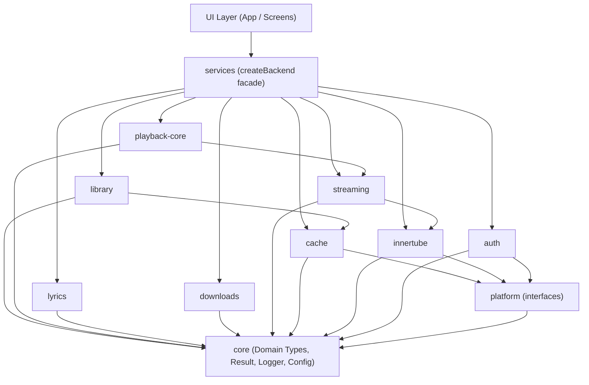
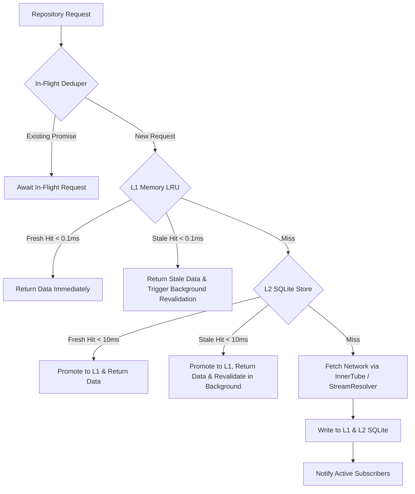

# Vitro Music Player - Backend Architecture

## 1. Overview & Priorities

Vitro Music Player backend is a modular, high-performance, testable TypeScript foundation for an unofficial YouTube Music client built inside an Expo (React Native) project.

### Core Priorities (in order)

1. **Speed**: Sub-100ms cached screen responses, lightweight memory footprint.
2. **Responsiveness**: Stale-while-revalidate (SWR), background revalidation, in-flight request de-duplication.
3. **Audio Quality**: Best available bitrate selection (Opus > AAC), format prioritization, loudness normalization metadata.
4. **Modularity**: Strict ports-and-adapters architecture; isolated domain modules with ESLint-enforced boundaries.
5. **Testability**: Pure Node.js execution via memory adapters without requiring an emulator or UI layer.

---

## 2. Architectural Principles

### Ports and Adapters (Hexagonal Architecture)

- **Ports (Interfaces)**: Domain modules interact exclusively with platform abstractions defined in `platform`:
  - `HttpClient`: Transport for HTTP requests.
  - `SecureStore`: Encrypted storage for authentication tokens and session cookies.
  - `KeyValueStore`: Key-value persistence for settings and fast metadata.
  - `SqlDatabase`: Structured relational storage for cache, history, offline mutations, and playlists.
  - `FileStore`: Binary filesystem storage for cached tracks and offline downloads.
- **Adapters**:
  - `platform/memory`: In-memory implementations for pure Node testing and CLI execution.
  - `platform/rn`: Native Expo/React Native implementations (`expo-secure-store`, `expo-sqlite`, `expo-file-system`, `fetch`).

### Strict Module Encapsulation

- Every module resides in `src/backend/<module>/`.
- Every module exposes its public API through a single barrel file: `src/backend/<module>/index.ts`.
- Deep internal imports into another module's internals (e.g. `import from '@/backend/innertube/parsers/search'` or `import from '../innertube/parsers/search'`) are strictly forbidden and blocked by ESLint.
- No backend code may import from `react` or `react-native`, with the sole exception of adapters inside `src/backend/platform/rn/`.

### Module Dependency Hierarchy

### Explicit Allowed-Dependencies Matrix

To maintain architectural purity and prevent cyclic couplings, cross-module imports are restricted to this explicit dependency matrix (strictly enforced by ESLint):

| Module              | Allowed Imports                                                                                         | Rationale / Prohibited Dependencies                                               |
| :------------------ | :------------------------------------------------------------------------------------------------------ | :-------------------------------------------------------------------------------- |
| **`core`**          | _None_                                                                                                  | Foundation domain models, Result, errors, logger. Cannot depend on any module.    |
| **`platform`**      | `@/backend/core`                                                                                        | Port interfaces and pluggable adapters.                                           |
| **`innertube`**     | `@/backend/core`, `@/backend/platform`, `@/backend/auth`                                                | YouTube endpoint client, parser layer. Uses transport and auth session.           |
| **`auth`**          | `@/backend/core`, `@/backend/platform`                                                                  | Session storage and header generators.                                            |
| **`cache`**         | `@/backend/core`, `@/backend/platform`                                                                  | SWR caching engine (LRU/SQLite). **Strictly forbidden from importing innertube**. |
| **`streaming`**     | `@/backend/core`, `@/backend/platform`, `@/backend/innertube`                                           | Stream resolver and player format strategies.                                     |
| **`library`**       | `@/backend/core`, `@/backend/platform`, `@/backend/innertube`, `@/backend/auth`, `@/backend/cache`      | User library, playlists, optimistic mutation queue.                               |
| **`playback-core`** | `@/backend/core`, `@/backend/platform`, `@/backend/streaming`, `@/backend/innertube`, `@/backend/cache` | Headless playback engine, state machine, prefetch queue.                          |
| **`lyrics`**        | `@/backend/core`, `@/backend/platform`                                                                  | LRCLIB client and timestamp parser.                                               |
| **`downloads`**     | `@/backend/core`, `@/backend/platform`, `@/backend/streaming`, `@/backend/cache`                        | Offline download manager and storage budget.                                      |
| **`services`**      | _All modules_                                                                                           | Composition root (`createBackend`). No module may depend on services.             |

---

## 3. Module Catalog

| Module              | Responsibility                                                                                                                                                         | Key Interfaces & Exports                                                 |
| :------------------ | :--------------------------------------------------------------------------------------------------------------------------------------------------------------------- | :----------------------------------------------------------------------- |
| **`core`**          | Shared domain models (`Track`, `Album`, `Artist`, `Playlist`), `Result<T, E>`, typed errors, logger with redaction, clock, event emitter, perf markers.                | `Result`, `Track`, `Logger`, `Clock`, `EventEmitter`                     |
| **`platform`**      | Port interfaces and pluggable adapters (`memory` and `rn`).                                                                                                            | `HttpClient`, `SecureStore`, `KeyValueStore`, `SqlDatabase`, `FileStore` |
| **`innertube`**     | YouTube Music endpoint client (search, browse/home, album, artist, playlist, next/radio, continuations), visitorData/locale handling, and defensive Zod-based parsers. | `InnertubeClient`, `SearchResponse`, `BrowseResponse`                    |
| **`auth`**          | Cookie/session management via SecureStore, SAPISID/visitor token headers, session health checks, `setSessionFromCookies()` ingestion.                                  | `AuthService`, `Session`                                                 |
| **`streaming`**     | Pluggable stream resolution strategies, audio format ranking (high-bitrate Opus > AAC), signature/token handling, URL expiration tracking and re-resolution.           | `StreamResolver`, `AudioStream`                                          |
| **`cache`**         | Multi-tier cache (in-memory LRU + SQLite), stale-while-revalidate policies, in-flight request coalescing.                                                              | `CacheManager`, `CachePolicy`                                            |
| **`library`**       | User playlists, liked songs, playback history, optimistic mutations, offline mutation queue with retry logic.                                                          | `LibraryService`, `MutationQueue`                                        |
| **`playback-core`** | Headless playback state machine (play, pause, next, prev, shuffle, repeat, auto-queue), prefetch planner, and `AudioEngine` interface.                                 | `PlaybackStateMachine`, `AudioEngine`                                    |
| **`lyrics`**        | Timed LRC parsing, multi-provider lyrics engine with LRCLIB provider and fallback ordering.                                                                            | `LyricsProvider`, `ParsedLyrics`                                         |
| **`downloads`**     | Offline track download manager, queue, pause/resume, storage quota budget, metadata indexing.                                                                          | `DownloadManager`                                                        |
| **`services`**      | Composition root: `createBackend(adapters)` returning a unified, strongly-typed facade for UI consumption.                                                             | `createBackend`, `Backend`                                               |

---

## 4. Error Handling & Defensive Boundary Validation

1. **Defensive Parsing with Zod**:
   - The unofficial InnerTube API evolves without public changelogs.
   - All external HTTP response payloads must pass through defensive Zod schemas at the boundary.
   - Optional or renamed properties must degrade gracefully into safe domain defaults rather than throwing unhandled exceptions.

2. **Result Pattern**:
   - Operations that can fail return `Result<T, E>` (`{ ok: true, value: T }` or `{ ok: false, error: E }`).
   - Domain errors are strongly typed classes or discriminated unions, avoiding raw exception throwing in business logic.

---

## 5. Security & Privacy

1. **Redaction in Logging**:
   - Sensitive headers (`Authorization`, `Cookie`, `X-Goog-Visitor-Id`, `SAPISIDHASH`) and tokens are redacted before outputting to logs.
2. **Credential Storage**:
   - Authentication tokens and session cookies are stored only in `SecureStore` (native keychain on mobile, memory adapter during tests).
3. **Repository Hygiene**:
   - Sensitive fixtures, cookie dumps, session files, and cache databases are explicitly excluded via `.gitignore`.
   - Recorded API fixtures must be scrubbed of user identifiers and session cookies.

---

## 6. Tooling & Verification Workflow

- **Unit Testing**: Vitest running in pure Node.js (`npm test`).
- **Terminal CLI**: Node runner via tsx (`npm run cli -- <command>`) for exploring endpoints without starting the React Native runtime or emulator.
- **Architectural Linting**: ESLint flat config (`npm run lint`) enforces cross-module import boundaries and prevents React Native imports in domain code.
- **Type Checking**: TypeScript strict mode (`npm run typecheck`).
- **Formatting**: Prettier (`npm run format` / `npm run format:check`).

---

## 7. Cache Architecture & Design

### Two-Tier Storage Architecture

1. **L1 In-Memory LRU (`LruCache`)**:
   - Sub-millisecond synchronous retrieval ($< 0.1\text{ ms}$).
   - Tracks both item count (`maxEntries`, default 200) and byte size (`maxSizeBytes`, default 20 MB).
   - Evicts least-recently-used items when limits are exceeded.

2. **L2 SQLite Persistence (`SqlCacheStore`)**:
   - Durable relational persistence through the `SqlDatabase` port (`expo-sqlite` on device, `node:sqlite` / `MemorySqlDatabase` in Node).
   - Indexed table `cache_entries` on `key`, `data_type`, and `stale_until` for fast index scans and background pruning (`deleteExpired`).

### Stale-While-Revalidate (SWR) Engine

- **Fresh Hit**: Returned immediately without invoking the network fetcher.
- **Stale Hit**: Cached data is returned immediately ($< 1\text{ ms}$), satisfying the sub-100ms screen render requirement. In the background, `revalidateInBackground()` initiates an in-flight deduplicated fetch. When fresh data arrives, it updates the cache and notifies active subscribers registered via `observe...()`.
- **Miss**: Underlying fetcher executes via `InFlightDeduper`, writes fresh data to both tiers, and returns.

### Per-Data-Type Policies & Expiry-Aware Dynamic TTL

| Data Type     | Fresh TTL | Stale TTL | SQLite Persistence | Notes |
| :------------ | :-------- | :-------- | :----------------- | :---- |
| **`home`**     | 10 min    | 24 hours  | Yes (`true`)       | Feed shelves and carousels. |
| **`search`**   | 5 min     | 1 hour    | Yes (`true`)       | Query results with normalized whitespace and filter. |
| **`album`**    | 24 hours  | 7 days    | Yes (`true`)       | Album metadata and tracklist. |
| **`artist`**   | 12 hours  | 3 days    | Yes (`true`)       | Artist profile and discography. |
| **`playlist`** | 15 min    | 24 hours  | Yes (`true`)       | Curated/user playlist items. |
| **`suggest`**  | 30 min    | 2 hours   | Yes (`true`)       | Search autocomplete queries. |
| **`stream`**   | Dynamic   | Dynamic   | **No (`false`)**   | **In-Memory Tier Only**. Dynamic safety margin based on stream `expiresAt`. |

### Stream URLs In-Memory Only & Invalidation Rule

- **Rationale**: YouTube signed stream URLs are bound to the client IP address (via the `ip=` URL query parameter) and cryptographic signatures (`sig=`/`s=`). When a device switches networks (e.g. Wi-Fi to cellular or VPN), existing signed stream URLs immediately return **HTTP 403 Forbidden**.
- **Rule**: Stream URLs are marked `persistToSql: false` and are **never persisted to SQLite**.
- **Invalidation**: `invalidateStream(videoId)` purges the cached stream entry from memory, guaranteeing that the next playback attempt re-resolves a fresh URL under the current network route.

### Parsed Domain Models (Not Raw Responses)

The cache strictly stores parsed domain models rather than raw InnerTube JSON payloads:
- Discards all tracking tokens, command metadata, visual styling trees, and menu overlays.
- Stored payload sizes:
  - `search`: ~5.1 KB (vs ~150–300 KB raw response; **~97% reduction**)
  - `home`: ~13.6 KB (vs ~200–400 KB raw response; **~95% reduction**)
  - `album`: ~6.1 KB (vs ~120 KB raw response; **~95% reduction**)
  - `artist`: ~6.5 KB (vs ~130 KB raw response; **~95% reduction**)
  - `playlist`: ~8.3 KB (vs ~100 KB raw response; **~92% reduction**)
  - `next`: ~2.3 KB (vs ~80 KB raw response; **~97% reduction**)
  - `suggest`: ~0.4 KB (vs ~10 KB raw response; **~96% reduction**)
  - `stream`: ~0.3 KB (vs ~180 KB raw player response; **~99.8% reduction**)

### Auth Isolation & Logout Purge (`clearUserScopedData`)

- Cache keys are generated via `CacheKeyBuilder` and strictly scoped:
  - Guest queries: `browse:home:auth:guest`, `search:...`
  - User-authenticated queries: `browse:home:auth:user:<id>`, `auth:user:<id>:search:...`
- On user logout or account switch, `clearUserScopedData()` purges all entries scoped under `auth:user:*` from both L1 memory LRU and L2 SQLite, while preserving anonymous guest cache entries.

### Prefetch Planner (`PrefetchPlanner`)

- Proactively monitors the active playback queue.
- Given the current track index, prefetches audio stream URLs for the next 1–2 tracks.
- Skips tracks already warm in cache and re-resolves any stream within 5 minutes of provider expiration.

### Dependency Rules & Boundary Enforcement

- `cache` is a low-level module that imports **only `core` and `platform`**.
- `cache` is **strictly prohibited from importing `innertube` or `streaming`** (enforced by ESLint).
- The repository layer (`MusicRepository` in `services`) serves as the mediator between InnerTube, Streaming, and Cache.

